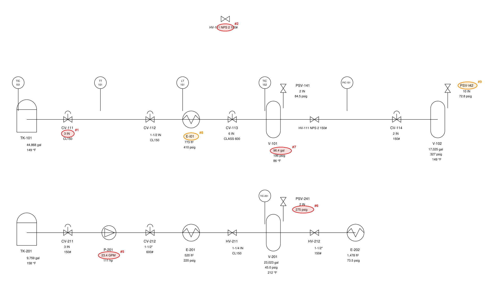

# pidcheck

[](https://github.com/mouadhassal/pidcheck/actions/workflows/ci.yml)

**Check a P&ID against its equipment list, and show the evidence for every finding.**

pidcheck reads a P&ID and the list it should agree with, then reports every tag, value, size and rating
that disagrees:
- **Drawings:** DXF, or a vector PDF exported from CAD.
- **Lists:** an equipment list in Excel or CSV, or the plant's DEXPI data export.

It handles the cases that make this hard in practice:
- **Unit conversions:** GPM ↔ m³/h, psig ↔ barg.
- **Nominal designations:** NPS 3" is DN 80, and Class 150 is PN 20, by table rather than by conversion.
- **Pressure references:** gauge versus absolute.
- **Number formats:** decimal commas.
- **Tag spellings:** P101, P–101, TICSA 4750.03.
- **Ambiguous labels:** a label floating between two symbols is reported as "needs a human look", not guessed.

**No language model makes a decision.** Text is read from the file, linked to tags through CAD structure
and geometry, and compared by code that is unit-aware and rounding-aware. Every finding carries a
confidence level and the reason for it.



```
$ pidcheck examples/example.dxf examples/example_equipment.xlsx --out report
27 tags on the drawing, 29 in the list; 47 values compared, 43 agree
#1   ERROR   high   CV-111 size: drawing says 3 IN, list says DN50. Nominal DN 80 vs DN 50
#2   ERROR   medium HV-111 appears 2 times on the drawing
#3   ERROR   high   P-101 (Centrifugal pump) is in the equipment list but not on the drawing
#4   ERROR   high   P-102 (Centrifugal pump) is in the equipment list but not on the drawing
#5   ERROR   high   P-201 flow: drawing says 23.4 GPM, list says 5.88 m³/h. 9.6% apart; rounding allows 0.28%
#6   ERROR   high   PSV-241 pressure: drawing says 275 psig, list says 23.7 barg. 20.0% apart; rounding allows 0.36%
#7   ERROR   high   V-101 volume: drawing says 96.4 gal, list says 96.4 m³. 99.6% apart; rounding allows 0.05%
#8   WARNING high   'E-I01' uses a letter where a digit belongs; read as E-101
#9   WARNING high   'PSV-I42' uses a letter where a digit belongs; read as PSV-142

7 error(s), 2 warning(s)
report: report/report.html
```

The drawing is in US units (GPM, psig, inches) and the list is metric (m³/h, barg, DN). The 43 values that
agree were matched across units, within each value's display rounding. The 9 findings are exactly the 9
faults planted in this sheet (`examples/example.truth.json`), with no false alarms.

## Results

### Synthetic P&IDs with planted faults (pre-registered)

The held-out test was pre-registered before the test set existed. The predictions and pass/fail
thresholds were frozen together with a hash of the code ([PREREGISTRATION.md](PREREGISTRATION.md)), and
the result was committed before any fix.

| Set | Drawings | Planted faults | Caught exactly | Caught or flagged for review | False alarms | Precision of high-confidence errors |
|---|---|---|---|---|---|---|
| Held-out test, frozen code (DXF) | 40 | 280 | 278 (99.3%) | 278 | **0** | 100% (196) |
| Held-out test, frozen code (PDF) | 40 | 280 | 278 (99.3%) | 279 | **0** | 100% (198) |
| Fresh confirmation set, final code (DXF) | 40 | 295 | 290 (98.3%) | **295 (100%)** | **0** | 100% (208) |
| Fresh confirmation set, final code (PDF) | 40 | 295 | 290 (98.3%) | **295 (100%)** | **0** | 100% (208) |

- **All 7 pre-registered hypotheses passed.** The 2 misses were exactly where I predicted the risk: a
  drifted valve-size label on a crowded sheet, linked to the vessel next to it.
- **The fix came after the test, so I didn't trust it on that set.** "Field-aware relinking" means a pipe
  size can't belong to a vessel that has no size in the list. I checked it on 40 new drawings it had never
  seen. There, nothing slipped through silently: 290 faults were caught exactly, and the other 5 (labels
  genuinely between two tags) were raised as warnings for a human.
- **Values that agree:** 2,507 on the confirmation set, of which 1,536 needed a unit conversion. Each
  drawing takes about 55 ms (DXF) or about 17 ms (PDF).

**What the sheets contain:**
- **Faults:** wrong values, unit slips ("150 GPM" written as "150 m³/h"), wrong sizes and ratings, missing
  and extra items, duplicated tags, tags with a letter for a digit, transposed tags, and duplicate rows in
  the list.
- **Traps that must not be flagged:** unit systems, DN against NPS, PN against Class, gauge against
  absolute, decimal commas and tag spellings.
- **On the test sets only:** rotated labels, crowded sheets and different text anchoring, none of which
  the development set had.

### Real CAD files: the public DEXPI test cases

[DEXPI](https://dexpi.org) is the ISO 15926 standard for exchanging P&IDs between CAD tools. Its public
[test cases](https://github.com/DEXPI/TestCases) contain vendors' XML exports and the PDFs their tools
drew. `python dexpi/study.py` runs pidcheck with the XML as the reference list.
[dexpi/FINDINGS.md](dexpi/FINDINGS.md) classifies every finding by hand.

- **Same tool (26 pairs: a tool's XML against the same tool's drawing):**
  - 22 pairs come back clean.
  - The 8 findings on the other 4 are real problems in the test cases, not false alarms. One example: the
    tag **V001 is given to two different valves** in C03.
  - All 62 values printed on these sheets agree with the XML, including "420.0 m^3/hr", "100.00 C" and
    "-1.0 barg".
- **Round trip (10 pairs: tool A's XML imported into tool B and drawn):**
  - The importer renames equipment (P-001 and W-001 instead of P4711 and H1008).
  - It drops tag labels: P4712 and SV 104.01.
  - It leaves data boxes empty ("/ / bar"), so no values could be compared.

The real files also taught pidcheck things the synthetic sheets could not:
- European tag styles;
- tags repeated in equipment data tables;
- IEC 81346 reference designations;
- exporter unit spellings.

Every synthetic set was re-run after those changes, with identical results.

## How it works

```
drawing ──read──▶ text + positions ──link──▶ tag → specs ──normalise──▶ SI + rounding ──compare──▶ findings
  (DXF: TEXT, MTEXT, block attributes · PDF: text lines)                     ▲
equipment list (xlsx / csv / DEXPI xml) ──read──▶ tag → specs ──normalise────┘
```

1. **Read** (`extract.py`). Every piece of text, with its estimated centre: TEXT, MTEXT (formatting
   stripped), and block attributes, which keep the INSERT they belong to. Vector PDFs give text lines with
   positions. Scanned PDFs are refused with a clear message, because they need OCR first.
2. **Link** (`associate.py`). Each spec is attached to a tag, from most to least certain:
   - **Attribute:** the spec is in the same block as the tag, which is how CAD P&ID tools store data.
   - **Inline:** the spec is in the same text, as in `CV-102 3" 150#`.
   - **Proximity:** the label is nearest to one tag, but only when that tag is at least 1.6× closer than the
     next one. Otherwise the label is **ambiguous**, and it is only resolved if exactly one candidate's list
     value matches it.
   - Instrument bubbles split over two lines ("FT" above "101") are merged into one tag.
   - **Field-aware relinking:** a size label nearest to a vessel that has no size in the list moves to the
     nearby valve that has one.
3. **Normalise** (`units.py`). Every value goes to SI and remembers its display precision:
   - "34.1 m³/h" means 34.05–34.15, so 150 GPM (34.07 m³/h) agrees with it and 160 GPM does not.
   - Nominal sizes and flange ratings are designations, so they are compared through the ASME B36.10 /
     ISO 6708 and EN 1759 tables. DN 80 equals NPS 3", even though 3 in is 76.2 mm.
   - When one pressure is unmarked, gauge is assumed, and the report says so.
4. **Compare** (`check.py`). Missing, extra and duplicated tags; typos (a letter for a digit, transposed
   digits); and value, size and rating mismatches. Every finding has a severity, a confidence level and
   the evidence for that confidence.
5. **Report** (`report.py`). Console output, plus a self-contained HTML page with the annotated drawing, a
   JSON file and a CSV file. The exit code is 1 when there are errors, so it can gate CI or a
   document-control step.

### Why no model decides anything

I measured what happens when it does. In
[judge-drift](https://github.com/mouadhassal/judge-drift), an LLM judge agreed with the reference 99.3% of
the time in English and 93.1% in Estonian. Having the model only extract the value and letting code
compare closed the gap. A P&ID check is the same problem with higher stakes.

Where a model belongs here is reading what text extraction cannot:
- symbols without text;
- scanned sheets;
- free-text notes.

Its output should feed the same deterministic comparison. That is the natural next step.

## Use

```bash
pip install -e .            # Python 3.10+
pidcheck drawing.dxf equipment.xlsx --out report/
pidcheck drawing.pdf plant_dexpi.xml --json
```

**Equipment list:** the header row is found automatically (the first row with a "Tag" column). Units are
read from the header ("Design flow (GPM)") or from the cells ("150 GPM"). A bare number with no unit
anywhere is reported as a list problem, never guessed.

## Reproduce

```bash
pip install -e ".[dev]" && pytest -q                       # 52 tests
python synth/generate.py --set test --out data/test        # 40 held-out drawings, DXF + PDF + list + truth
python bench/run.py data/test --out results/test.json
python synth/generate.py --set confirm --out data/confirm  # 40 fresh drawings for the amended checker
python bench/run.py data/confirm --out results/confirm.json
python dexpi/study.py                                      # downloads the DEXPI test cases, writes results/dexpi.json
python tools/codehash.py                                   # hash of the code the pre-registration froze
```

## Limits

- **The synthetic drawings and the checker have the same author.** High scores show the logic handles the
  cases it was designed for. The DEXPI files are real CAD output, but they are small demonstration plants,
  not a client's production sheets.
- **Text only.** pidcheck reads text, not symbols, so an unlabelled valve is invisible to it. Scanned PDFs
  need OCR first.
- **One reading per field.** Design and operating values of the same kind on one item are compared as a
  set; they aren't told apart yet.
- **The 1.6× ambiguity margin and the 9-text-height link radius were tuned on these sheets.** Sheets drawn
  at very different label densities may need them adjusted. Both are named constants in `associate.py`.
- **PDF reading uses PyMuPDF,** which is AGPL-licensed. pidcheck's own code is MIT.

## Layout

| Path | What |
|---|---|
| `pidcheck/extract.py` | Text and positions from DXF (TEXT, MTEXT, ATTRIB) and vector PDF |
| `pidcheck/associate.py` | Tag recognition, instrument-bubble merge, linking specs to tags, ambiguity |
| `pidcheck/units.py` | Quantities, unit conversion, display rounding, NPS/DN and Class/PN tables |
| `pidcheck/tags.py` | ISA and DIN/IEC tag styles, confusable characters, typo pairing |
| `pidcheck/equiplist.py`, `pidcheck/dexpi.py` | Equipment list from xlsx/csv, or from DEXPI XML |
| `pidcheck/check.py` | The comparison and its findings |
| `pidcheck/report.py`, `pidcheck/render.py` | HTML/JSON/CSV report; DXF → vector PDF renderer and annotations |
| `synth/generate.py` | Synthetic P&IDs with planted faults and traps |
| `bench/run.py` | Scoring against the planted faults |
| `dexpi/` | Real-world study on the DEXPI test cases |
| `PREREGISTRATION.md`, `results/` | Frozen predictions and every result file |

MIT licence. Built by [Mouadh Abderrahmane Assal](https://mouadh.vercel.app).
